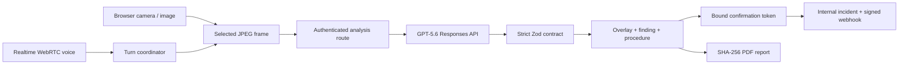

# Aegis-OS

The realtime multimodal inspection OS that sees visible faults, locates them, guides corrections, takes approved action, and preserves a verifiable evidence trail.

## The problem

Electronics technicians often inspect equipment with occupied hands, fragmented instructions, and no consistent record of what was visible before a correction. A missed connector, delayed incident, or weak evidence trail forces repeated work. Aegis-OS makes the camera, voice loop, spatial findings, procedure, approvals, and report one coherent workspace.

## Users

Electronics technicians, field-service engineers, hardware labs, maintenance operations, and technical QA teams. Aegis-OS is not a medical device and does not certify electrical safety.

## Working product flow

Sign in → choose camera or owned sample → start Realtime voice → request inspection → capture an actual frame → GPT-5.6 returns a strict spatial result → render and persist the finding → correct the visible issue → analyze a newer frame → approve an incident → complete → download a checksummed PDF → reopen history.



## OpenAI integration

The browser never receives `OPENAI_API_KEY`. `POST /api/realtime` authenticates a signed Aegis session, derives a SHA-256 safety identifier, assembles the versioned electronics prompt, and forwards the WebRTC SDP to `POST https://api.openai.com/v1/realtime/calls` using `gpt-realtime-2.1`. Server VAD supports immediate barge-in. The data channel exposes only the schema-bound `request_precision_analysis` tool.

`POST /api/analysis` sends the selected high-quality frame to the Responses API using environment-configurable `gpt-5.6`, high image detail, and strict JSON Schema. The result is revalidated with Zod, including coordinate bounds, evidence requirements, frame references, enum closure, and passed-step evidence. One malformed response is retried; a second failure becomes a controlled error. GPT-5.6 performs the central scene-quality, visible-fault, localization, procedure, and verification work—it is not decorative.

## Codex use and human decisions

Codex created the implementation, interaction design, API boundaries, schemas, confirmation protocol, spatial transform, PDF output, tests, judge assets, and submission documentation in the primary project task. The human builder supplied the product mission, required closed loop, electronics focus, technology constraints, design direction, risk policy, and hackathon priorities. No development history or Session ID has been invented.

## Features

- Signed, organization-scoped judge session
- Camera, microphone, upload, and owned fault/corrected targets
- Realtime browser WebRTC voice with real audio-level waveform and interruption
- Actual frame capture; no continuous video upload or audio recording
- Strict GPT-5.6 inspection contract with spatial overlays
- Newer-frame correction verification and procedure progression
- Exact-argument confirmation tokens and replay rejection
- Always-available internal incident plus optional HMAC-signed external webhook
- Append-style session timeline, local history replay, and evidence states
- Actual PDF report with SHA-256 checksum
- Honest errors for permission, credential, schema, network, and delivery failures
- Responsive technical workspace for desktop, tablet, and mobile

## Technology

Next.js 16 App Router, React 19, strict TypeScript, Tailwind CSS, Zod, OpenAI JavaScript SDK, PDF-Lib, Lucide, WebRTC, MediaDevices, Web Audio, local browser persistence, Vitest, and Vercel-compatible route handlers.

## Local setup

Requirements: Node.js 20.9+ and pnpm 10+.

```bash
pnpm install
copy .env.example .env.local
pnpm dev
```

Set `OPENAI_API_KEY`, a random 32+ character `SESSION_SECRET`, and optionally the signed webhook values. The Realtime and inspection model names default to the required models. There is no mock production fallback.

## Environment variables

| Variable | Purpose |
|---|---|
| `OPENAI_API_KEY` | Server-only Realtime and Responses API authentication |
| `OPENAI_REALTIME_MODEL` | Defaults to `gpt-realtime-2.1` |
| `OPENAI_INSPECTION_MODEL` | Defaults to `gpt-5.6` |
| `SESSION_SECRET` | Signs sessions and exact action confirmations |
| `AEGIS_EXTERNAL_WEBHOOK_URL` | Optional separately deployed incident receiver |
| `AEGIS_EXTERNAL_WEBHOOK_SECRET` | HMAC-SHA256 signing key |
| `NEXT_PUBLIC_APP_URL` | Deployment origin |

## Persistence and database

The current MVP persists inspection state and completed history in the authenticated browser profile; server integrations are stateless. This makes the complete single-device judge path durable across refreshes but is not a production multi-device database. A production deployment must replace this repository with organization-scoped PostgreSQL/Supabase tables and RLS before claiming multi-device tenancy. This limitation is intentional and disclosed, not hidden behind simulated records.

## Tests

```bash
pnpm lint
pnpm typecheck
pnpm test
pnpm test:integration
pnpm test:e2e
pnpm build
pnpm eval
```

The offline evaluation in `evals/reports/latest.*` measures contract enforcement only. It makes no unmeasured model-accuracy claim.

## Judge path and sample data

Follow [JUDGE_TESTING_INSTRUCTIONS.md](JUDGE_TESTING_INSTRUCTIONS.md). The original generated assets in `public/judge-kit` show the same de-energized board with J2 disconnected and correctly seated. They are alternate image inputs, not precomputed AI results; both use the live analysis route.

## Deployment

Production is deployed at https://aegis-os-delta.vercel.app as a Node.js Next.js application. HTTPS, signed workspace authentication, security headers, and PDF generation were verified against production. The live GPT-5.6 request reaches OpenAI with an accepted strict schema but currently returns `429 exceeded current quota`; API billing/credits must be enabled before the judge flow can complete.

## Security and privacy

Secrets stay server-side; session and action inputs are signed and validated; confirmations bind exact arguments; duplicate confirmation is rejected; CSP and Permissions Policy are set; webhook deliveries use HMAC and timeouts. Raw audio and continuous video are not stored. See [SECURITY.md](SECURITY.md).

## Build Week record, limitations, and license

See [BUILD_WEEK_DEVELOPMENT_RECORD.md](BUILD_WEEK_DEVELOPMENT_RECORD.md), [IMPLEMENTATION_STATUS.md](IMPLEMENTATION_STATUS.md), and [docs/judging/KNOWN_LIMITATIONS.md](docs/judging/KNOWN_LIMITATIONS.md). Licensed under MIT; judge assets are project-owned AI-generated material documented in [ASSET_LICENSES.md](docs/judging/ASSET_LICENSES.md).
