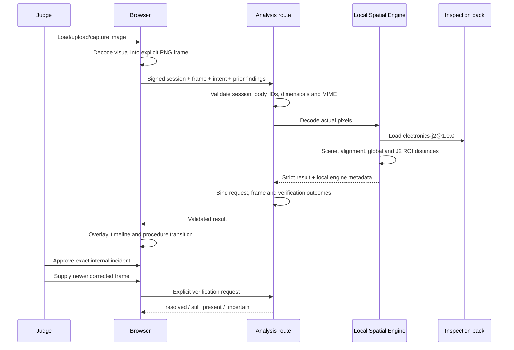

# Submitted data flow

Continuous video and raw audio remain in the browser. Only an explicit captured frame is sent. The server does not persist evidence in this MVP. Browser Speech Recognition and speech synthesis are device-native controls; they are not OpenAI Realtime.
